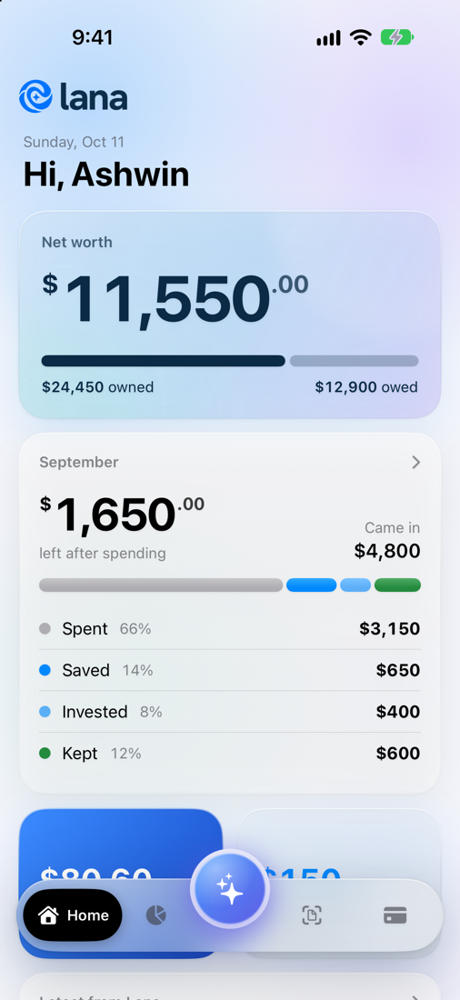
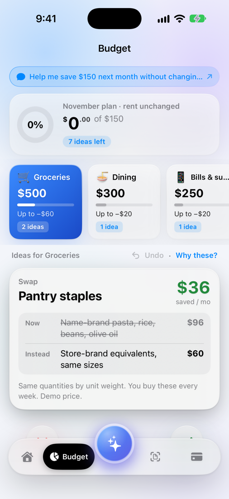
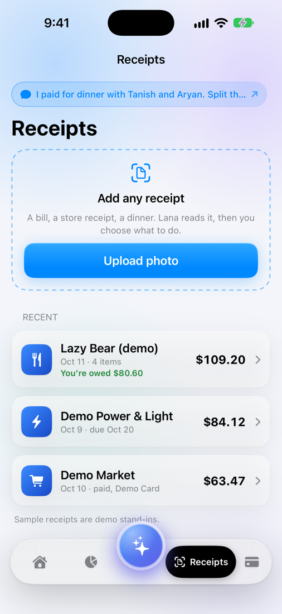
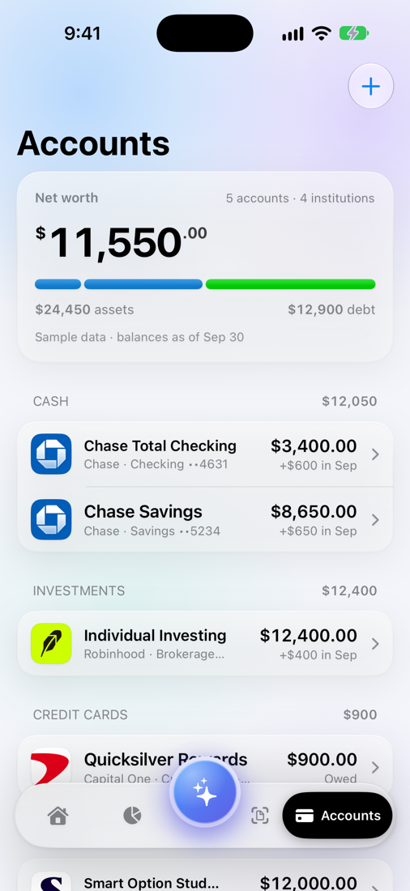
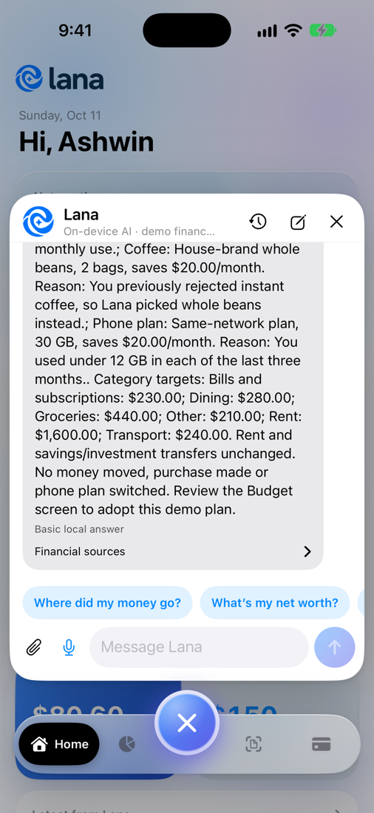
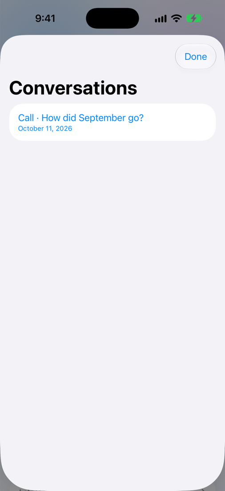
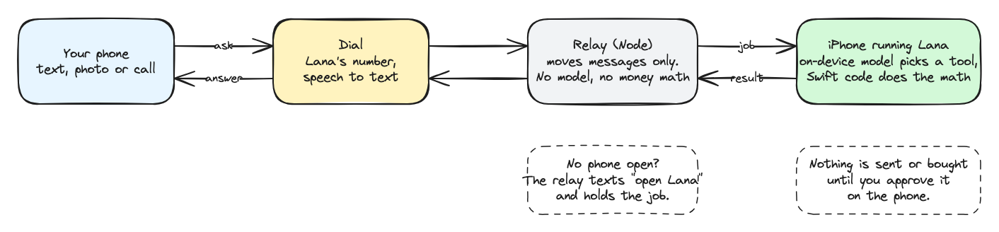
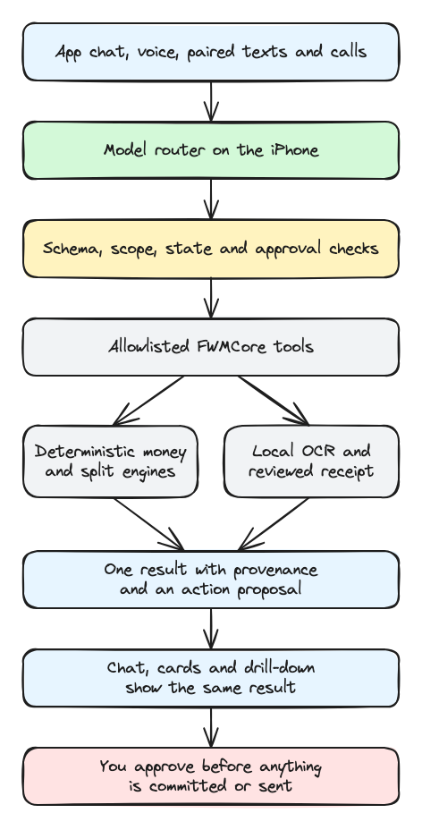

# Lana

My money lives in five apps. Every one shows me a balance. Not one tells me what to do.

So we built Lana. You don't open a dashboard. You text it, or call it, like the friend who's good with money. The model runs on your phone, code does every calculation, and nothing moves until you approve it.

Tanish, Aryan and Ashwin built it at SpeedHacks on October 11, 2026. The code still calls it Financial World Model (FWM), because that's where we want it to end up. Lana would understand your whole money world and live where you already talk, in iMessage and WhatsApp. This README covers what already works.

**Demo video:** link added at submission.

| Home | Budget | Receipts |
|:---:|:---:|:---:|
|  |  |  |
| **Accounts** | **Chat** | **Call history** |
|  |  |  |

These are from the iOS simulator on `main`, with synthetic September data. The call in the last one was real. We called Lana's number from a phone, Dial transcribed it, and the app answered.

## One evening with Lana

It's Sunday night. Ashwin just paid $109.20 for dinner with Tanish and Aryan, and September just closed. Splitting that bill by hand took Aryan 22 minutes. We timed it. Reading the receipt, doing the math, sending the requests, checking they went through. And the monthly review and finding money to save? Nobody ever gets to that part.

Here's the same evening with Lana.

**He texts the receipt.** Ashwin doesn't open an app. He texts Lana a photo of the receipt and says who had what. Dial gives Lana a real phone number. The app is closed, so Lana texts back and tells him to open it.

**He approves the split.** Lana reads the receipt on the phone, and nothing goes to a cloud AI. Ashwin checks each line and Lana does the math. Tanish owes $36.40, Aryan owes $44.20, and Ashwin's share is $28.60. That's $109.20, to the cent. Lana sends nothing until he approves.

**He calls on the walk home.** "How did September go?" Dial turns his voice into text. The question goes to his phone, the model there answers, and Dial reads the answer back. Afterward the call sits in Lana's history, next to his chats.

**He finds $150 a month.** "What can I swap to save money?" Lana picks store-brand pantry staples, concentrated detergent and a cheaper plan on the same network. For coffee it picks whole beans, not instant, because Ashwin turned instant down last time. When he approves, the phone checks it's really him. Until then nothing changes.

## Time saved

| Chore | By hand | With Lana | Where the number comes from |
|---|---|---|---|
| Split the dinner bill | 22 min, measured | In the demo video | `/timer` stopwatch, logged to Keewano |
| Month review | 15 min | Not measured | Team estimate |
| Budget and swaps | 20 min | Not measured | Team estimate |

Lana's time counts checking every receipt line and approving each request. Setup happens once. You pair the phone with the relay in Accounts → Messaging → Configure messaging relay, using a code the relay gives you. The relay serves the live receipt at `GET /v1/time-receipt`.

## Partners

| Partner | What it does for Lana | Code |
|---|---|---|
| Dial | Gives Lana a real phone number. Texts and receipt photos come in on Dial's event stream, and replies go out through Dial. Calls use Dial's Self-Hosted mode, so Dial handles the speech and the answer comes from the phone. | `relay/src/server.ts`, `relay/src/voice.ts` |
| Keewano | Remembers which swaps you turned down, like instant coffee, so Lana stops suggesting them. It also stores the measured chore times behind the time receipt. | `relay/src/keewano.ts` |
| Sparta Worlds | We tested the code that applies an approved phone-plan switch. Our first version switched a plan without approval and applied a repeated request twice. It passed 1 of 4 cases, and 0 of 4 when the billing server failed. The fixed version passes all 4 both ways. | `sparta/README.md`, `sparta/evidence/` |

## How a text or call gets answered



The relay never runs a model and never touches money math. It carries jobs between Dial and the phone. To edit the diagram, open `docs/diagrams/flow.excalidraw` in [Excalidraw](https://excalidraw.com).

## Private by design

The model runs on your phone, so your financial data never goes to a cloud AI or a data company. That's what lets Lana get personal. It learns your brands, your habits and the choices you've made. Code does every calculation, and nothing moves without your approval.

## Who pays, and what's next

We're starting with young professionals whose money already spans several apps. Lana makes money two ways: a $10 a month subscription, and referral fees when someone adopts one of its fixes, like a cheaper phone plan. You pick the swap, and we never sell your data.

Next comes broader bank coverage beyond SimpleFIN, then iMessage and WhatsApp, then shared money for roommates and couples.

## Run it

- **App.** Open `Examples/LanaDemoApp/LanaDemoApp.xcodeproj`, pick the LanaDemoApp scheme and run on iOS 26+. Chat answers need Apple Intelligence.
- **Relay.** `cd relay && npm install && npm test`, then `npm start`. Copy `.env.example` to `.env` and add the Dial and Keewano keys.
- **Swift tests.** `swift test`, and `swift test --package-path Packages/FWMCore`.
- **Sparta.** Steps are in `sparta/README.md`.

## What isn't real yet

- The bundled bank data is synthetic: a three-year history (default) or one September month, switchable in Accounts › Data. Real accounts come in through SimpleFIN Bridge (a paid service that links your bank; the phone reads it directly, and Refresh pulls new transactions) or a CSV statement import. Linking with no SimpleFIN account uses SimpleFIN's own demo bank.
- Dial can't text US numbers until 10DLC registration clears, so the demo sends texts from the relay's `/phone` page. Calls work from any phone.
- iOS won't let Lana answer in the background. That's why the relay texts you to open it.
- The Budget screen labels its preference history as simulated. The live Keewano connection is in the relay.

---

# Team notes: Financial World Model

An iPhone financial assistant that turns accounts, transactions, preferences, and receipts into useful answers and reviewable actions in one conversation. Built for SpeedHacks, October 11, 2026. Working name: **Financial World Model (FWM)**. Team: **Tanish, Aryan, and Ashwin**.

The product gives people time back by reducing the work of understanding their money, planning a budget, comparing alternatives, and splitting receipts. An on-device model interprets requests; deterministic engines compute every financial number. The user reviews changes before anything is committed or sent.

**Start here:** [Technical architecture and collaboration guide](docs/README.md). It covers ownership, shared interfaces, setup, tests, branches, commits, and merge procedures.

**Assign next work:** [Team task list](TODO.md) tracks suggested owners, dependencies, acceptance criteria, and version 1 follow-ups.

**AI branch handoff:** [Concrete Swift integration and verification](docs/AI_INTEGRATION.md) describes the canonical agent, adapter protocols, local receipt/voice APIs, and approval gate.

## Version 1

`main` now contains **Lana 1.0**: Ashwin's native screens connected to Tanish's local AI and Aryan's engines, providers and relay. Open `Examples/LanaDemoApp/LanaDemoApp.xcodeproj`, select **LanaDemoApp**, choose your signing team and an eligible iPhone, then Run. Requires iOS 26+ with Apple Intelligence ready for conversational inference. The app bundles its fixture; a Mac checkout is not needed at runtime.

Tap the centre orb for natural-language chat, PDF attachments, saved conversations and reviewed voice input. Split supports local receipt-image OCR followed by field/assignment review. Home, Budget and chat share the selected budget projection. Accounts provides real device authentication and optional HTTPS relay pairing. See [version 1 setup, verification and limits](docs/VERSION_1.md).

## What we are building

The current shared implementation follows the SRS v2 contracts referenced by `FWMCore`. The v2 document is in the team chat, not checked into this repository. The earlier broad SRS describes the product vision; it does not override the interfaces already shared here.

| Workflow | User request | App behavior |
|---|---|---|
| Understand my money | Where is my money going? | Show income, spending, savings, investments, retained cash, and net worth with evidence |
| Budget and swaps | Help me save more | Build a deterministic proposal and cheaper alternatives that respect preferences; approve before committing |
| Receipt and split | Split this dinner | Extract text locally, review items/contacts, reconcile the receipt, compute exact shares, preview requests before sending |

Supporting work includes local model routing, receipt OCR, on-device voice transcription, provider adapters, messaging relay, reminders, credential storage, and provider MFA support.

## Who is building what

| Owner | Primary scope |
|---|---|
| **Tanish** | On-device model and routing; scoped tool dispatch and approval gates; OCR/voice; vault/MFA; AI integration into the iOS host |
| **Aryan** | Aggregator adapters; messaging relay; money and split calculations; sponsor integrations |
| **Ashwin** | Demo data; three feature UIs; budget/swap logic; presentation |

`FWMCore` contracts are shared. The iOS host combines Tanish's AI infrastructure with Ashwin's feature views; host ownership does not transfer ownership of those views.

## Architecture



Source: `docs/diagrams/arch.excalidraw`, editable in [Excalidraw](https://excalidraw.com).

The shared product plan uses **local inference, without a cloud LLM**. The relay carries jobs/messages and provider responses. It does not run inference or calculate money. Remote provider calls are separate from model processing. iOS background execution is constrained; the relay must handle an unavailable or foreground-required phone explicitly.

## Repository layout and status

| Path | Responsibility | Version 1 status |
|---|---|---|
| `Packages/FWMCore/` | Shared records/contracts; money and split engines; provider adapters (fixture, bank CSV import); golden tests | Merged on `main`; fixture-backed app; CSV adapter available as a library |
| `fixtures/` | Canonical and edge inputs, generator | Canonical seed plus expanded three-year world; Ashwin owns changes |
| `Examples/LanaDemoApp/`, `Packages/FWMFeatureUI/` | Integrated iPhone host, screens and composition adapters | Version 1 entry point |
| `relay/` | Dial inbox/outbox, job transport, reminders, Keewano | Merged; pairing and foreground worker wired in Accounts |
| `sparta/` | Sparta Worlds tests for the approved-action executor (phone-plan swap) | Merged; sandbox executor and recorded evidence |
| `docs/README.md` | Technical contracts and collaboration procedure | Shared documentation |
| Root `Package.swift`, `Sources/FinanceAI/`, `Tests/FinanceAITests/` | Tanish's reusable local AI module | Merged and connected to feature screens |
| `Examples/AIPlayground/` | AI-only SwiftUI test harness | Retained developer harness; use LanaDemoApp for the integrated product |

The AI module includes free-form Foundation Models chat with native finance/PDF tools, local conversation history, PDF text/scanned-page import, Vision OCR, local Speech transcription, confirmation orchestration, passcode-protected Keychain storage, and RFC-tested TOTP generation. Its harness uses the canonical v2 dataset and shared money/split engines. Foundation Models is the initial backend; **MLX is an option to evaluate, not an installed dependency**. A cloud routing prototype on that branch is unused and is not part of the agreed integrated architecture.

Update this status when components change. Distinguish implemented code, successful compilation, actual model inference, and physical-device verification.

## Run the checks

From the repository root:

```bash
swift test --package-path Packages/FWMCore
```

Also run:

```bash
swift test
swift run ai-diagnostics
```

Diagnostics identify whether routing used the local model or deterministic fallback. Passing fallback samples do **not** establish model quality. The AI package uses Swift tools 6.2+ and targets iOS 26+ / macOS 26+. `FWMCore` uses Swift tools 5.9+ and supports iOS 17+ / macOS 14+.

## Canonical demo numbers

Read these from the engines. Do not duplicate financial constants in prompts or UI.

| Result | Expected value |
|---|---:|
| September net income | $4,800.00 |
| Expenses | $3,150.00 |
| Transferred to savings | $650.00 |
| Transferred to investments | $400.00 |
| Retained cash | $600.00 |
| Net worth | $11,550.00 |
| Dinner total | $109.20 |
| Ashwin / Tanish / Aryan shares | $28.60 / $36.40 / $44.20 |
| Outstanding reimbursements to Ashwin | $80.60 |

## Shared conventions

- Store/calculate **integer USD cents**. Entering an account is positive; leaving is negative. Liability balances are positive amounts owed.
- Use `FWMJSON.encoder` / `FWMJSON.decoder` for snake_case wire JSON; keep stable IDs.
- Preserve `Provenance`: chat, card, and drill-down for a calculation share one `result_id`.
- The model proposes an allowlisted tool. It cannot calculate amounts, select authenticated identity, issue approval tokens, or read credentials.
- Bind human approval to action, user/conversation, payload, version, and expiry. Duplicate delivery must not execute twice.
- Keep fixture, sandbox, live, and cached modes visible; identify mocked actions.
- Keep secrets, recordings, personal receipts, and build artifacts out of Git.
- Use focused feature-branch commits and reviewed PRs; preserve history with merge commits. Direct `main` updates require explicit agreement, including shared setup and approved integration releases.

Read [the technical guide](docs/README.md) before changing shared contracts, fixtures, build settings, or another owner's files.

## Expanded synthetic fixtures

The isolated three-year world, canonical demo and October dinner live under
`fixtures/world-v1`. Read [the data handoff](docs/synthetic-data.md) for explicit
scenario loading, metric definitions, accounting assumptions and schema gaps.
Run `python3 -m tools.synthetic_data.validate` from the root to check the data
and existing Swift engine goldens. Legacy fixture files remain unchanged.
