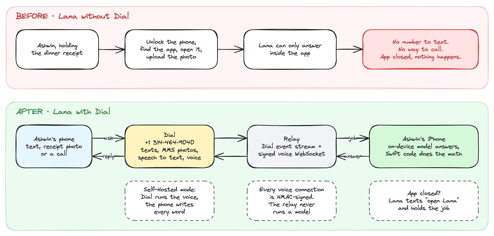
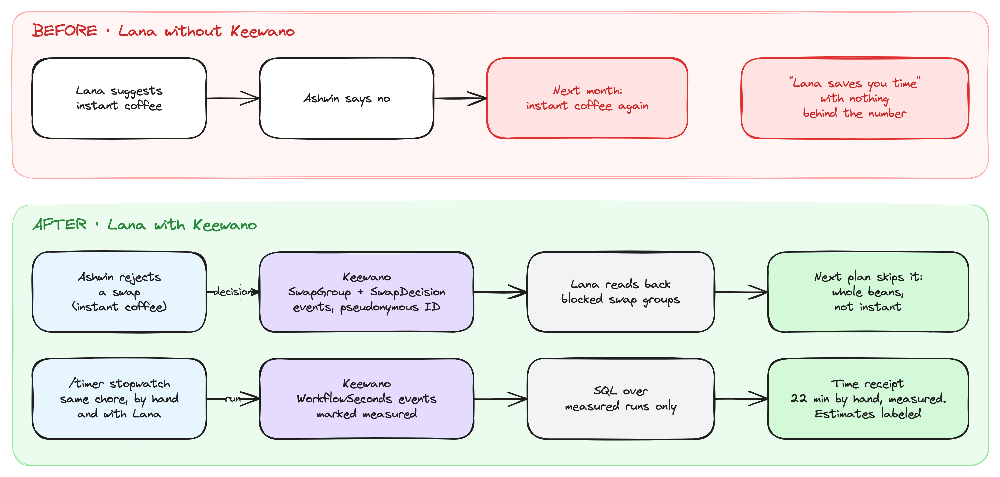
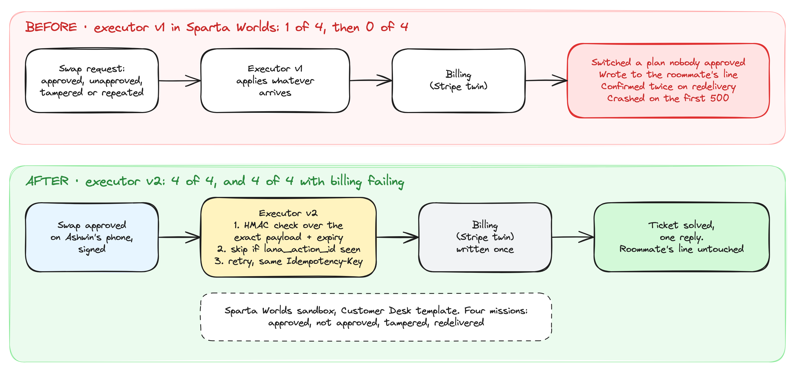

# Lana

My money lives in five apps. Every one shows me a balance. Not one tells me what to do.

So we built Lana. You don't open a dashboard. You text it, or call it, like the friend who's good with money. The model runs on your phone, code does every calculation, and nothing moves until you approve it.

Tanish, Aryan and Ashwin built it at SpeedHacks on October 11, 2026. The code still calls it Financial World Model (FWM), because that's where we want it to end up. Lana would understand your whole money world and live where you already talk, in iMessage and WhatsApp. This README covers what already works.

**Demo video:** link added at submission.

| Home | Budget | Receipts |
|:---:|:---:|:---:|
|  |  |  |
| **Accounts** | **Chat** | **Call history** |
|  |  |  |

These are from the iOS simulator on `main`, with synthetic September data. The call in the last one was real. We called Lana's number from a phone, Dial transcribed it, and the app answered.

## One evening with Lana

It's Sunday night. Ashwin just paid $109.20 for dinner with Tanish and Aryan, and September just closed. Splitting that bill by hand took Aryan 22 minutes. We timed it. Reading the receipt, doing the math, sending the requests, checking they went through. And the monthly review and finding money to save? Nobody ever gets to that part.

Here's the same evening with Lana.

**He texts the receipt.** Ashwin doesn't open an app. He texts Lana a photo of the receipt and says who had what. Dial gives Lana a real phone number. The app is closed, so Lana texts back and tells him to open it.

**He approves the split.** Lana reads the receipt on the phone, and nothing goes to a cloud AI. Ashwin checks each line and Lana does the math. Tanish owes $36.40, Aryan owes $44.20, and Ashwin's share is $28.60. That's $109.20, to the cent. Lana sends nothing until he approves.

**He calls on the walk home.** "How did September go?" Dial turns his voice into text. The question goes to his phone, the model there answers, and Dial reads the answer back. Afterward the call sits in Lana's history, next to his chats.

**He finds $150 a month.** "What can I swap to save money?" Lana picks store-brand pantry staples, concentrated detergent and a cheaper plan on the same network. For coffee it picks whole beans, not instant, because Ashwin turned instant down last time. When he approves, the phone checks it's really him. Until then nothing changes.

## Time saved

| Chore | By hand | With Lana | Where the number comes from |
|---|---|---|---|
| Split the dinner bill | 22 min, measured | In the demo video | `/timer` stopwatch, logged to Keewano |
| Month review | 15 min | Not measured | Team estimate |
| Budget and swaps | 20 min | Not measured | Team estimate |

Lana's time counts checking every receipt line and approving each request. Setup happens once. You pair the phone with the relay in Accounts → Messaging → Configure messaging relay, using a code the relay gives you. The relay serves the live receipt at `GET /v1/time-receipt`.

## Built with Dial, Keewano and Sparta

Each partner does a job we couldn't have faked in a day.

### Dial gave Lana a phone number

Without Dial, Lana is one more finance app you have to remember to open. With Dial it's a contact in your phone. Text it a receipt photo and it splits the bill. Call it on the walk home and it tells you how September went. In our tests, text answers came back in 4 to 5 seconds, and receipt photos reached the phone byte for byte.

The piece that matters most is Self-Hosted mode. Dial runs the call, the speech to text and the voice. Every word of the answer comes from the model on Ashwin's phone. That's how a phone call to Lana keeps the same promise as the app: your bank data stays on your device.

Code: `relay/src/server.ts` for texts, photos and nudges, `relay/src/voice.ts` for calls.

### Keewano is Lana's memory, and our proof

Keewano does two jobs. The first is memory. When Ashwin turns down instant coffee, that decision goes to Keewano as an event, and Lana reads back which swaps to stop suggesting. The preference lives in Keewano, so it doesn't get lost when a conversation ends.

The second is proof. Every stopwatch run goes into Keewano as a measured event, and the time receipt is a SQL query over those rows. When we say the dinner split took 22 minutes by hand, there's a row for it.

Code: `relay/src/keewano.ts`, and the live receipt at `GET /v1/time-receipt`.

### Sparta caught the bugs we least wanted you to find

Lana is allowed to change things for you, like switching your phone plan. That's the scariest part of the product, so we tested it in Sparta Worlds against a Stripe twin before it touched anything real.

Our first executor failed badly. It switched a plan nobody approved. It wrote to the roommate's line when the request was tampered with. It confirmed twice when the same request arrived again, and it crashed on the first billing error. It passed 1 of 4 missions, and 0 of 4 with the billing server failing.

Version 2 checks the phone's signature over the exact payload, remembers which actions it already applied, and retries with a stable idempotency key. It passes all 8 runs. We found every one of those bugs in Sparta, not in front of a user.

Code: `sparta/README.md`, with the four run reports in `sparta/evidence/`.

## How a text or call gets answered

The relay never runs a model and never touches money math. It carries jobs between Dial and the phone. To edit the diagram, open `docs/diagrams/flow.excalidraw` in [Excalidraw](https://excalidraw.com).

## Private by design

The model runs on your phone, so your financial data never goes to a cloud AI or a data company. That's what lets Lana get personal. It learns your brands, your habits and the choices you've made. Code does every calculation, and nothing moves without your approval.

## Who pays, and what's next

We're starting with young professionals whose money already spans several apps. Lana makes money two ways: a $10 a month subscription, and referral fees when someone adopts one of its fixes, like a cheaper phone plan. You pick the swap, and we never sell your data.

Next comes broader bank coverage beyond SimpleFIN, then iMessage and WhatsApp, then shared money for roommates and couples.

## Run it

- **App.** Open `Examples/LanaDemoApp/LanaDemoApp.xcodeproj`, pick the LanaDemoApp scheme and run on iOS 26+. Chat answers need Apple Intelligence.
- **Relay.** `cd relay && npm install && npm test`, then `npm start`. Copy `.env.example` to `.env` and add the Dial and Keewano keys.
- **Swift tests.** `swift test`, and `swift test --package-path Packages/FWMCore`.
